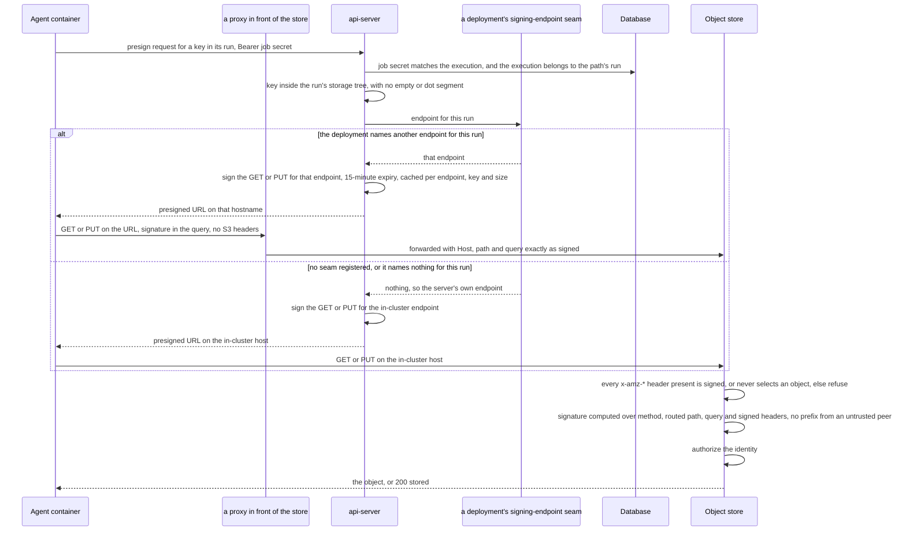
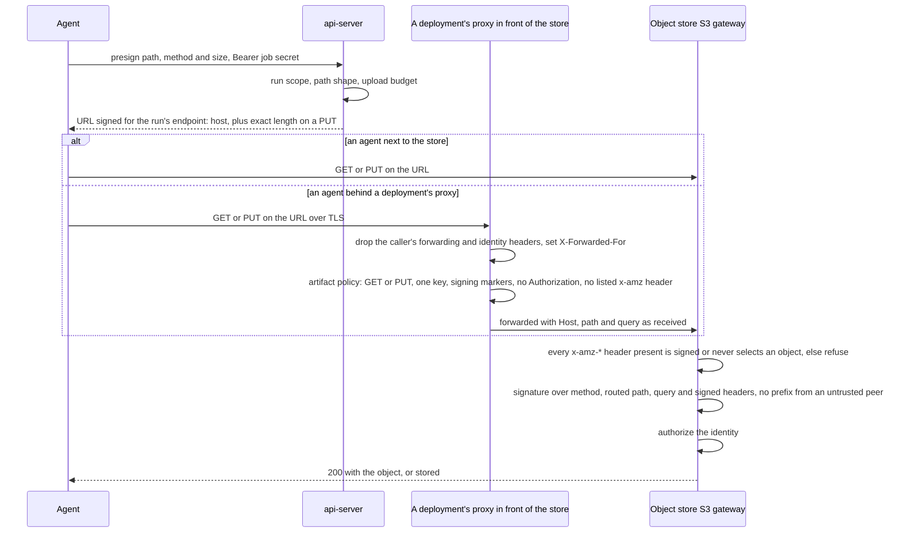
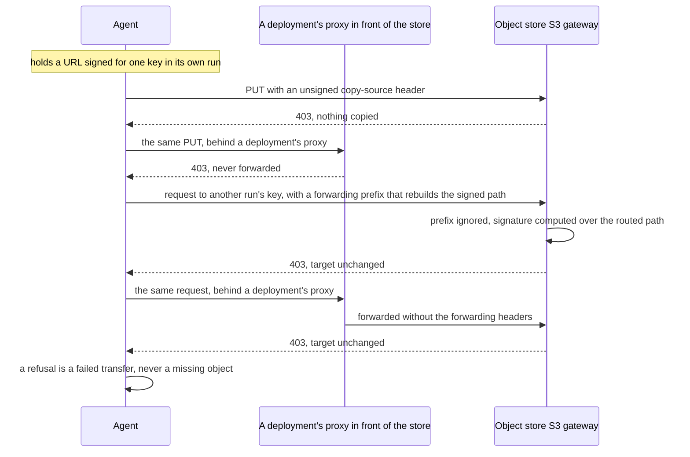
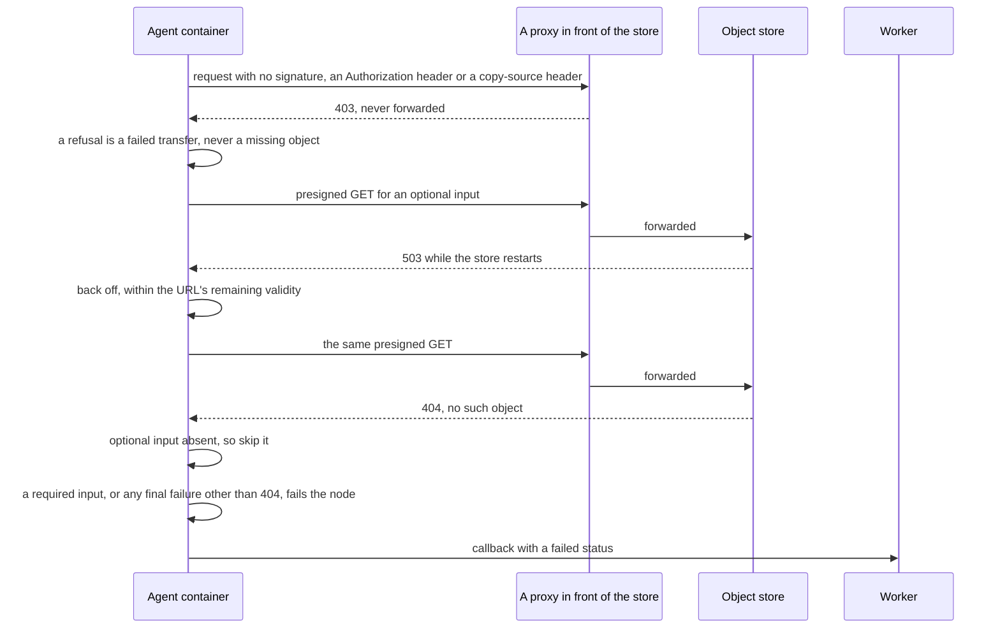
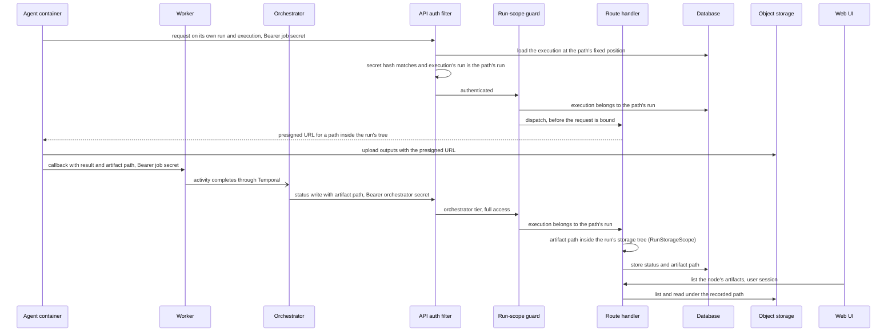
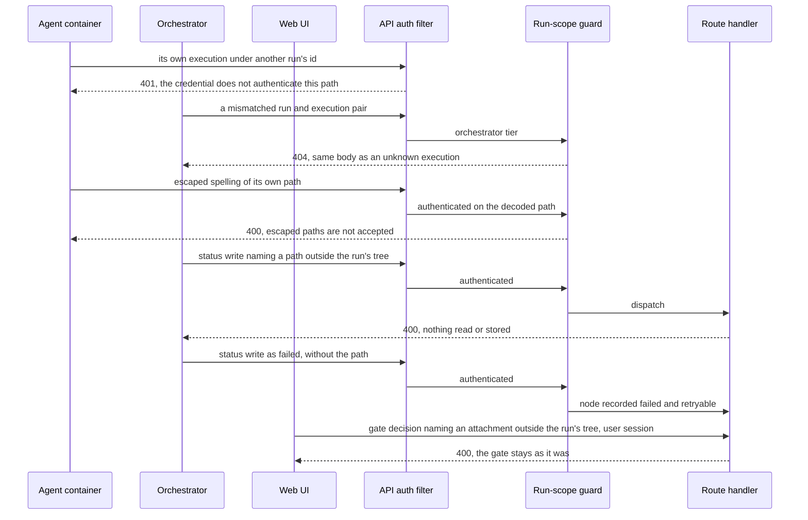
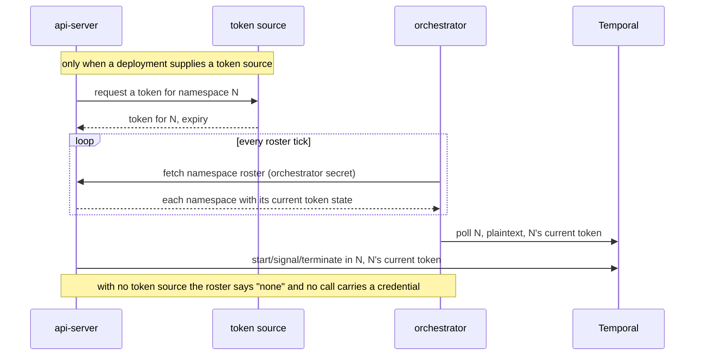

# ChorusKube Architecture

A contributor-facing overview of how ChorusKube turns a workflow definition into a
running set of AI-agent tasks. For a project overview see [README.md](README.md);
to run the stack see [QUICKSTART.md](QUICKSTART.md).

## The graph / template model

A workflow is a **directed graph** — a "graph template" — whose nodes are units of
work:

- **AI-agent tasks** — run [Claude Code](https://claude.com/claude-code) inside an
  agent container to do real software work.
- **Scripts** — run a command in a container.
- **Human-approval gates** — pause the run until a reviewer approves, rejects, or
  routes it.

Edges connect the nodes into a DAG. A template is the reusable shape of a workflow;
the **target git repo (`git_repo_id`) is a run input**, supplied when you start a
run, not baked into the template. The same template can therefore run against many
repos.

## The run lifecycle

When a run starts, a **Temporal-backed orchestrator** walks the DAG: it decides
which node runs next, follows edges, and applies conditional routing based on the
outcome of each node (including human decisions at approval gates). Temporal gives
the walk durability and retries.

The orchestrator does **not** create containers itself. It dispatches each ready node
as a **Temporal activity**, and a **Worker** — a process subscribed to the node's task
queue — picks it up and creates the workload itself:

- an **isolated Docker container** when running locally, or
- a **Kubernetes Job** when running in a cluster.

The Worker owns the executor, and on a self-hosted install it also holds the
credentials: the Claude token and the GitHub PAT or App key, from its own credentials
folder. Before launching, it asks the **api-server** to resolve per-run configuration
(the workload `prepare` call), which carries no credential; when the agent
finishes, the Worker's own callback server receives the result and records execution
state back to the api-server (the workload `complete` call). The api-server is the
source of truth for state, but it is **out of the execution hot path** — it never
creates a container.

The executor is deliberately **tenant-agnostic**: it launches into a namespace, service
account, and credentials it is *given*, and resolves none of them itself. The
single-tenant core has one tenant, so the boundary is invisible here — but it is the
same boundary that lets a Worker run on infrastructure the operator controls without
reaching anything but its own work. Placement and credential scoping across more than
one Fleet are extension seams core declares but does not implement — see
[docs/decisions/2026-09-06---02-worker-placement-and-executor-seams.md](docs/decisions/2026-09-06---02-worker-placement-and-executor-seams.md).

**Workload lifetime.** The executor that launches a workload also bounds its own
lifetime, from a deadline (the node activity's own timeout, plus grace for the
workflow's failure path to read its logs first) and a retention (the Worker's
`WORKLOAD_RETENTION` setting, floored at the node's heartbeat timeout plus that same
grace) stamped on at launch. Kubernetes enforces this with `ActiveDeadlineSeconds` and
`TTLSecondsAfterFinished` on the Job, which also owns the ConfigMap and Secrets it
launched with. Docker has no equivalent, so the Docker executor labels every object it
creates with the bounds and runs its own janitor goroutine, which sweeps the daemon by
label on an interval and reclaims a workload once its state and bounds call for it —
see [docs/decisions/2026-11-09---02-launching-executor-bounds-workload-lifetime.md](docs/decisions/2026-11-09---02-launching-executor-bounds-workload-lifetime.md).

```
   ┌──────────┐  REST / WS   ┌──────────────┐  Temporal signals  ┌──────────────────┐
   │  web-ui  │ <──────────> │  api-server  │ <────────────────> │   orchestrator   │
   └──────────┘              │    state     │                    │ (Temporal driver)│
                             └──────┬───────┘                    └────────┬─────────┘
                                    │                                     │ dispatches each
                     PostgreSQL ────┤                                     │ node as an activity
                     object store ──┘                                     ▼
                                    ▲                             ┌──────────────────┐
                     prepare        │                             │      worker      │
                     complete (state)──── worker calls ───────────┤ owns executor +  │
                                                                  │ callback server  │
                                                                  └────────┬─────────┘
                                                                           │ creates per node;
                                                                           │ agent returns its
                                                                           ▼ result via callback
                                                                  ┌──────────────────┐
                                                                  │  agent container │
                                                                  │    or K8s Job    │
                                                                  └──────────────────┘
```

The orchestrator drives the graph; the **Worker** creates and owns the agent workloads;
the **api-server** owns state and talks to the data stores. It holds no credentials and has no GitHub client at all ([why](docs/decisions/2026-10-13---02-data-plane-credential-rule.md), [how it got there](docs/decisions/2026-11-10---01-self-hosted-server-holds-no-credential.md)); a test fails the build on any production source naming the GitHub API ([how](docs/decisions/2026-11-13---01-the-open-source-worker-is-local-only.md)).

Once a run completes, the orchestrator asks the api-server which repos the run touched and
each one's default branch, then dispatches a cleanup step to the run's own Worker, which
deletes each repo's run branch that is not ahead of its default branch. The Worker makes
those GitHub calls itself, with the run's token from its own credential source; the
api-server makes none. See
[docs/decisions/2026-10-13---01-branch-cleanup-on-the-worker.md](docs/decisions/2026-10-13---01-branch-cleanup-on-the-worker.md).

## Task-triggered runs

A **Task Delivery** run is started from a roadmap **Task** — the leaf of the
**Epic → Story → Task** hierarchy — rather than manually. A Task is startable only once its
Story has an approved spec: a **Story Design** run, started once per Story, produces that spec and
the Task breakdown, and each Task's Task Delivery run plans against it. A Task that finds the
Story spec wrong escalates to the Story, and the revision is a new Story Design run. See
[docs/decisions/2026-11-01---01-design-per-story-deliver-per-task.md](docs/decisions/2026-11-01---01-design-per-story-deliver-per-task.md).
Feature Development remains for runs started without a Task.

Starting a Task composes the run's `feature_request` input deterministically: the task-start
path (`DefaultTaskService`) walks the Task's parent Story and grandparent Epic and folds their
titles, descriptions, and the Epic's motivation into `feature_request`, with the Task as the lead
section and a labelled "Parent context" section beneath it. A blank or missing parent field is
omitted rather than rendered as an empty header, so a Task with no ancestry content degrades to a
Task-only prompt.

This composition happens once, at start — it is a point-in-time snapshot, not a live view.
To reach anything beyond it (the live ticket, open dependencies, sibling Tasks), the agent
system prompt for a task-triggered run points every AI node at the roadmap CLI
(`get-roadmap-graph`, which resolves this run's Epic server-side with no flags needed) as
the source of truth for current state.

## Roadmap proposals and gates

Some workflow templates include a **human-approval gate configured to review roadmap
changes** — the Final Approval of Feature Development and of Task Delivery, Story Design's
Approve Story Spec, and the Roadmap Provisioner's own gate. A gate like this declares a
`materialize` mode in its config:

- `roadmap_candidates` — the Roadmap Provisioner's mode: the proposal document
  describes wholly new Epic → Story → Task trees.
- `roadmap_extension` — the mode of Feature Development, Task Delivery and Story Design:
  the proposal may extend the run's own Epic (when the run was started from a Task or a
  Story) with new Stories and Tasks,
  or introduce a genuinely separate new Epic, but may not attach new items under any
  other existing Epic.

An agent node writes the proposal as an artifact, `roadmap_candidates.json`: a nested
Epic → Story → Task document, plus key-based dependencies between entries. Any Epic,
Story or Task entry may instead carry an `existingId`, turning it into an **anchor** —
an already-materialized item that nothing is created for, but that can hold new
children or serve as a dependency endpoint. The agent validates its own proposal
before installing it (`propose-roadmap`), against a server-side validator that checks
structure (unique keys, consistent anchor nesting, no dangling dependency keys), the
addressable invariant (every new Epic needs at least one Story, every new Story at
least one Task), and the active gate's scope rules.

Because a gate like this makes roadmap creation the reviewer's decision, the direct
roadmap-write routes (`create-proposal`, `update-proposal`, `create-story`,
`create-task`, `create-dependency`, `create-milestone`) are refused for any run whose
workflow declares a roadmap gate, with a message pointing at `propose-roadmap`
instead; the read routes stay available. Every agent-facing roadmap route also verifies the calling
node execution belongs to the run named in its path, so a caller cannot escape a
run's rule by naming a different run's id.

When the gate awaits a decision, the reviewer sees the proposal as an editable tree:
anchors render read-only with their live titles, filled in only when the anchor
resolves inside the run's own software project (project membership is the tenancy
boundary; a foreign or missing anchor cannot be told apart from the reviewer's view).
The reviewer can add new Stories/Tasks under an anchor, edit or remove new items, or
drop an anchor (which never deletes the item it points at). Approving re-validates
the edited document against the gate's rules before creating anything: a structural
violation (for example, a Story a reviewer added with no Task) is rejected with the
reasons, and the gate stays open for another edit. Nothing is created on a rejected
approval.

A Task created this way in `roadmap_extension` mode also gets a matching GitHub issue.
The run's Worker files it during the gate's finalize, after the roadmap write has
created the Task — not the agent, and not inline with that write. A retry finds an
issue it already opened by the task key hidden in the issue body, so filing is safe to
repeat. When the Task reaches `done`, the server starts a short workflow once the
completion commits: the run's own Worker closes the issue with its own credential,
waiting for a live Worker if none is currently polling, and the server then records the
result. Filing and closing are both best-effort: a filing failure is recorded alongside
the gate's result — naming any Task that has no issue — rather than blocking Task
creation, and a close that fails is logged and never blocks completion.

## Merging pull requests on approval

A human gate can declare `merge_pull_requests: <merge|squash|rebase>` in its config —
the Final Approval of Feature Development and of Task Delivery declares `squash`. The
method only takes effect on the `approved` decision; graph validation rejects the key on
a node with no such decision, and an unknown method.

On `approved`, the API validates the decision and any roadmap edit, moves the gate
from `awaiting_human` to `finalizing`, records the approval and signals the
workflow — no code-host call is made inside that request. The workflow then drives
the rest of the approval one event at a time: it asks the API for a plan, and the
Worker inspects and merges the run's registered pull requests — inspect first, refuse
the whole approval on a draft or a conflicting pull request, merge in registration
order pinned to the head commit seen during inspection, and skip a pull request
already closed or already merged. See
[2026-10-11---02](docs/decisions/2026-10-11---02-async-gate-finalize-on-the-worker.md)
and [2026-10-31---04](docs/decisions/2026-10-31---04-gate-approvals-finalize-only-asynchronously.md).

The API records the Worker's merges and completes the gate once every pull request has
been accounted for. A refusal — a draft, a conflict, or a GitHub-side rejection —
reopens the gate with the refusal reason instead of completing it; a pull request
already merged by that attempt stays recorded and merged, since a merge cannot be
undone.

A run found stale against the current default branch holds the approval instead of
acting on it and routes to its own re-check; the workflow re-applies the held approval
itself, inside its own event stream, the moment the gate reopens, so no reviewer click
can race it.

Task Delivery's Approve Task Spec and Final Approval also declare
`story_version_recheck`. While the Task's Story spec is under revision an approval is
refused; once the spec has moved past the version the run planned against, a click
routes to the re-check with the current spec instead of finalizing, a held approval is
voided rather than re-applied, and a plan is refused — so no Task merges against a
Story spec it was not re-checked against. See
[2026-11-01---01](docs/decisions/2026-11-01---01-design-per-story-deliver-per-task.md).

Pull request rows, Task closure and run-branch cleanup are unchanged: a merge
timestamp written by approval takes a row out of the reconciler's unmerged scan the
same way a reconciler-observed merge would.

## AI nodes and artifacts

An AI node runs Claude Code inside the agent container against the target repo.
Nodes are isolated from each other, so they exchange data through **artifacts**:
the api-server hands outputs to and from an **object store** using presigned URLs,
so containers read and write artifacts directly without proxying large blobs
through the api-server.

Inside an agent container the workspace is laid out as:

```
/workspace/
├── config.json   # run context for this node (read-only)
├── in/           # input artifacts from predecessor nodes
├── out/          # outputs written here are uploaded to the object store
└── repo/         # clone of the target git repo (if configured)
```

A node reads its task from `config.json`, does its work against `repo/`, and writes
results to `out/`; downstream nodes receive them in their `in/`.

### Who the presigned URL is signed for

The api-server always talks to the object store at its own configured endpoint —
that never changes. What *can* vary, per run, is the host a presigned URL hands to
the agent: a deployment whose agents cannot reach the server's own object-store
endpoint names, per run, a different endpoint to sign for instead, through a seam
(`ArtifactSigningEndpointResolver`). The open-source core ships only the default
implementation, which always answers "use the server's own endpoint" — so a
self-hosted install behaves exactly as before. A deployment that registers its own
seam implementation can sign for `https://artifacts.example.com` or similar for some
runs while every other run, and every server-side read or write, still goes through
the in-cluster endpoint.

A seam answer is validated before it is ever used to sign anything: it must be an
`http`/`https` scheme plus a host plus an optional port, nothing else — no path,
query, fragment, or userinfo. A seam that throws fails the presign request outright;
it is never treated as "no answer" and silently signed against the server's own
endpoint instead.

Presign also refuses, with 400 before signing anything, a requested key containing
an empty path segment (a leading, trailing, or doubled `/`) or a literal `.`/`..`
segment. A proxy in front of the store that normalises paths would rewrite such a
key, and the rewritten request no longer matches its signature; refusing the key at
signing keeps every key behaving the same whichever endpoint a run's URLs name.



### What the object store must refuse

A presigned URL is meant to authorize one method on one object. A header or query
parameter added after signing is not covered by the signature, so only the object
store, and anything in front of it, decides what such an addition can do. The
principle: **an input outside the signature may fail the request, or be dropped or
ignored before it acts, but it must never pick or change the object.** The store
computes the signature over the method, the path it routes on, the full query and
the headers named as signed; it refuses any `x-amz-*` header outside that set. A few
headers never select an object and are exempt — the payload hash and the signing
parameters echoed as headers. It never joins a caller's `X-Forwarded-Prefix` to the
path, because the trusted-proxy allowlist that would admit one is left empty on every
deployment.

`PresignedRequestStoreContractTest` holds this contract against the exact image this
repo's compose stacks and store-backed tests pin, between two runs, through the real
presign path:

| Request sent with a URL the real presign path minted | Expected |
|---|---|
| PUT carrying an unsigned copy-source that names another run's key, in every spelling | refused; the destination does not hold the source's bytes |
| PUT carrying an unsigned metadata-directive, tagging, ACL, user-metadata or made-up `x-amz-*` header | refused |
| GET and length-signed PUT sent to another run's key with a forwarding prefix that rebuilds the signed path | refused; the target unchanged |
| GET sent to the bucket's root with a forwarding prefix that rebuilds the signed path | refused; no listing returned |
| URL with an added query parameter (a subresource or an upload id) | refused |
| the same URLs sent unmodified | succeed, so the refusals above are not vacuous |

`web-ui/e2e/specs/presigned-request-contract.spec.ts` repeats the copy-source and
retarget refusals from inside a real agent container, against a URL the api-server
actually minted — the one hop the store-backed test cannot reach. Any store a
deployment of this project uses must leave its trusted-proxy allowlist empty, so a
caller-supplied forwarding prefix is never joined to the routed path. Why the pin that
both tests run against may only move to a release at or past 4.49, and what else was
considered: [docs/decisions/2026-11-25---01-object-store-acts-only-on-the-signed-object.md](docs/decisions/2026-11-25---01-object-store-acts-only-on-the-signed-object.md).



A request the signature does not cover is refused on both paths:



### How an upload is sized and budgeted

An upload is admitted once, at presign, and the URL it gets back enforces that
admission. The artifact CLI declares the exact byte count of the file it is about to
send; the api-server signs that length into the PUT URL, so the store refuses a body
of any other length — SigV4 can sign an exact length but not a maximum. Before
signing, the api-server books the size against the run's upload budget
(`objectstore.run-upload-budget`, 512 MB by default) in a reservation ledger: one row
per run and object key, holding the largest size that key was ever signed for, since
a presigned URL cannot be revoked once issued. The check and the booking run under a
lock on the run row, so two presigns racing for the last bytes of the budget admit at
most one. An unsized PUT presign gets 400, a closed run 409, and one past the budget
413; none of these carries a URL or books anything, and a GET presign books nothing.
Server-side writes (run inputs, gate attachments, the run log the orchestrator
appends) are not booked against this budget at all — they go through
`UploadService`/`S3Client` or the orchestrator's own object-store client, never
`InternalArtifactController`. Why each of these choices:
[docs/decisions/2026-11-18---01-agent-uploads-are-sized-and-budgeted-per-run.md](docs/decisions/2026-11-18---01-agent-uploads-are-sized-and-budgeted-per-run.md).

### How a transfer tells a missing object from a failed one

A transfer judges its own outcome rather than trusting a bare success or failure.
The agent's artifact CLI retries a connection failure, a timeout, or an HTTP
408/429/5xx, backing off within the presigned URL's remaining validity window, and
never retries a refusal (403) or a malformed request — those fail at once. A 404 on
a GET is reported as a distinct, final outcome, "no such object," apart from every
other failure. The entrypoint treats only that outcome as absent, and only for an
optional input or the run log, skipping it; a required input, or any other failure
on any input or output, fails the node instead of running — or reporting success —
against a workspace it could not confirm complete. Carrying a Claude session across a
quota hit is the one exception: a failure to save or restore it degrades to a fresh
run, since that is always a safe outcome.



## State and realtime updates

The **api-server is the single source of truth** for run and execution state,
persisted in **PostgreSQL**. When state changes — a node starts, finishes, or a run
reaches an approval gate — the api-server broadcasts the change over
**STOMP/WebSocket**. The web UI **subscribes** to these events and updates live; it
does not poll. This keeps the graph view and run monitor in sync with the
authoritative state without the UI hammering the API.

## Single-tenant model

The open-source core runs **single-tenant** with no external identity provider.
There is no login and no multi-org routing: every request resolves to a single
seeded **"system" organization**. That organization holds no credentials: the
Claude token and GitHub credential used for real runs live on the Worker. This
keeps the core simple to run locally and to self-host.

## Agent-route authentication

An agent authenticates every request with its execution's `JOB_SECRET` and names its run and
execution in the path. Two layers sit in front of a handler, each with a distinct job, plus a
containment rule every write that records a reference applies before it stores anything.

- **The auth filters** decide whether a credential authenticates the request, both reading the
  decoded path-within-application segments the router itself dispatches on, not the raw,
  still-escaped URI — so a percent-escaped spelling of either prefix is authenticated or refused
  exactly like the plain one. `InternalAuthFilter` gives the orchestrator secret full access to
  `/internal/**`. It accepts an agent's `JOB_SECRET` only at a fixed window: the decoded segments at
  positions 0–4 must be exactly `internal`, `runs`, a run id, `node-executions`, an execution id;
  both ids must parse as UUIDs; the execution must exist with a matching `job_secret_hash`; **and
  its own run must equal the run id at that window.** An execution id anywhere else in the path
  authenticates nothing. `WorkerAuthFilter` only proves a bearer was presented on `/worker/**`,
  deciding from the same decoded first segment; each handler's `WorkerAuthorizer` then checks the
  Fleet's pin on the path's run.
- **The run-scope guard** (`RunScopeInterceptor`) runs after the filters and before any handler
  binds its request. It refuses a percent-escaped path with 400, and refuses an execution that does
  not belong to the path's run with 404 — the same body an unknown execution already gets. It
  enforces both rules without relying on the filters, so a regression in a filter alone reopens
  neither. With internal auth enforced, an agent never reaches it with a cross-run pair, because the
  internal filter refuses that pair first. The callers its 404 answers are the ones no filter checks against the run: the
  orchestrator tier, and every caller on an execution-scoped `/worker/**` route.
- **Write-side containment** (`RunStorageScope`, shared with presign) runs inside the handler, once
  the guard has already confirmed the execution belongs to the path's run. Every write that records
  an artifact or attachment reference — a node's status, its review history, a gate's decision —
  refuses a path outside the run's own storage tree with 400, before reading or storing anything.
  Pull-request registration and a repo-base report apply the equivalent rule to a repository,
  refusing one that is not among `GraphSnapshotBuilder.reposForRun` with 404. A run start holds its
  `inputAttachmentRefs` to the same shape of rule one step earlier, against the caller's own
  staging area rather than a run that does not exist yet: `UploadService.admitStagingRefs` refuses
  a key outside `{prefix}/staging/` or a name the upload sanitiser would have changed, before the
  run row, quota check, placement, preflight, or any object-store call. A deployment whose storage
  prefix differs per organisation gets this containment for free through the same storage-prefix
  seam the staging key is built from.

`web-ui/e2e/specs/agent-run-scope.spec.ts` proves all three against a running stack with two runs'
real `JOB_SECRET`s: one run's secret is refused on every agent route the server's `/v3/api-docs`
lists whenever the path names the other run or its execution, and its own routes refuse an
artifact path, repository or presign target outside its run.





## Control-plane Temporal authentication

The api-server calls Temporal on one connection shared by every namespace, and the orchestrator
on one connection per namespace it serves; by default neither presents a credential — the
open-source behaviour, unchanged. A deployment whose
Temporal checks per-namespace tokens supplies a **control-plane token source**: a Spring bean the
api-server looks up at construction time. For a namespace it answers one of three things — a
bearer token with its expiry, "this deployment presents no credential," or a failure. A failure
is always reported "unavailable," never "none": collapsing the two would let a transient failure
of the source look exactly like a deployment that never meant to present a credential, and a
caller would then send a call with no credential where one was actually required. With no source
configured, every namespace is "none."

- **The api-server attaches each call's token by the namespace the request itself names**, on the
  one connection every namespace already shares. A gRPC client interceptor reads the outgoing
  request's `namespace` field once the message is known and either attaches that namespace's
  token or — when the deployment issues tokens and this namespace's is unavailable — fails the
  call before it ever reaches the transport. A request naming no namespace carries no header.
- **With a token source configured, the api-server refuses to boot** unless `InternalAuthFilter`
  is enforcing with an orchestrator secret configured. Tokens travel to the orchestrator on the
  namespace-roster route below, and only that combination keeps that route the orchestrator's
  alone.
- **The orchestrator's namespace roster carries each namespace's token state** alongside the
  namespace list it already returns, bounded below the orchestrator's own timeout for the roster
  call: a namespace the source cannot answer within that bound is reported "unavailable" rather
  than stalling every other namespace in the same response. The orchestrator holds the most
  recent state per namespace and reads it fresh on every call, so a renewed token applies without
  reconnecting, and an "unavailable" push keeps whatever token is already held until it expires.
- **The orchestrator always dials Temporal in plaintext explicitly**, so presenting a token never
  flips a live connection's transport. It attempts its configured namespace immediately at
  startup and retries every unserved namespace on every roster tick — the configured one
  included, even when the roster cannot be fetched — rather than waiting for a first roster
  before serving anything. It exits only when
  Temporal refuses a namespace it already holds a token for, when it refuses one the roster marked
  "none," or when Temporal cannot be reached at all for the configured namespace at startup —
  every other outcome, including a refusal the token source simply hasn't caught up to yet, is
  logged and retried on the next tick.



## Components

| Component | Stack | Responsibility |
|-----------|-------|----------------|
| **api-server** | Java / Spring Boot | Source of truth for state; records Worker-reported execution state and holds no credentials; REST API; STOMP/WebSocket broadcasts. |
| **orchestrator** | Go + Temporal | Drives the graph; dispatches each node as a Temporal activity for a Worker to execute. |
| **worker** | Go + Temporal | Runs executors (Docker, Kubernetes) and the agent callback server; receives work from Fleets; holds the install's credentials and makes the run's GitHub calls (gate merges, run-branch cleanup, roadmap issue filing). |
| **web-ui** | React + Vite | Graph visualization, live run monitoring, human-approval gates; subscribes to WebSocket events. |
| **agent images** | container images | The containers a node runs in — the AI agent (Claude Code) and a fuller dev image built on top of it. |

See the [Components section of README.md](README.md#components) for the
fuller per-component description.
