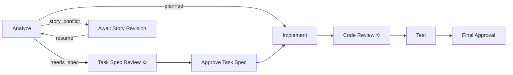

<!-- DO NOT add a # H1 heading here — the title comes from index.json and is rendered by the web UI -->

## Overview

ChorusKube is an AI-powered software delivery platform. This page provides a high-level tour of
all major capabilities. Click any feature name to read the dedicated guide.

## Core Features

| Feature | Description | Guide |
|---|---|---|
| Workflow Templates | Directed-acyclic-graph (DAG) templates define reusable automation pipelines | [Workflow Templates](workflow-templates) |
| AI Agent Nodes | Claude Code agent pods that write code, commit changes, and open PRs autonomously | [AI Agent Nodes](ai-agent-nodes) |
| Human Gates | Pause points requiring a human approval before the workflow continues | [Human Gates](human-gates) |
| Multi-Repo Support | Run workflows across multiple repositories using Repository Groups | [Multi-Repo Support](multi-repo-support) |
| Analytics | Run trend charts, throughput metrics, and bottleneck detection | [Analytics](analytics) |
| Pull Request Tracking | Capture and display PR URLs opened by agent nodes in the run detail view | [Running Workflows](running-workflows) |
| Roadmap | Epic → Story → Task backlog hierarchy, with Tasks startable as workflow runs | [Roadmap](roadmap-and-proposals) |
| Story Design and Task Delivery | A Story is designed once; each of its Tasks is then planned and delivered on its own | [Roadmap](roadmap-and-proposals) |

## AI-Powered Agents

Each AI node in a workflow run spawns a **Claude Code agent pod** that:

- Reads context from `/workspace/config.json` and the accumulated run log
- Writes output files to `/workspace/out/`
- Commits code changes to a working branch
- Opens a Pull Request via the GitHub API
- Submits a routing decision (`report-result`) that controls which edge the workflow follows next

See [AI Agent Nodes](ai-agent-nodes) for the full lifecycle.

## Human Gates

**Human Gates** pause a workflow at a designated node and notify reviewers via the **Approvals** page.
Reviewers can:

- Read the AI agent's output and attached artifacts
- Approve or reject the gate — the workflow routes accordingly

See [Human Gates](human-gates) for details.

## Multi-Repo Support

A single workflow can operate across multiple repositories simultaneously using **Repository Groups**.
Each repository gets its own Kubernetes namespace with provisioned RBAC and network policies.
The agent workspace exposes all repos under `/workspace/repo/<name>/`.

See [Multi-Repo Support](multi-repo-support) for setup and best practices.

## Analytics & Observability

The **Analytics** dashboard provides:

- Run volume trends over configurable time periods
- Throughput metrics (runs started vs. completed)
- Bottleneck detection — which node types take the longest
- Per-node timing breakdowns

See [Analytics](analytics) for interpretation guidance.

## Pull Request Tracking

When an AI agent opens a Pull Request, the PR URL is captured and displayed in the **Run Monitor**
alongside the node that created it. All PR links are accessible from the run detail view, each
showing a Merged / Open / Closed state badge.

Approving a human gate configured to merge pull requests (the Final Approval of Feature Development
and of Task Delivery) merges every registered PR before the run completes. If GitHub refuses a merge — a draft PR,
conflicts, a missing approving review — the reason is shown and the gate stays open; PRs already
merged are skipped on a retry.

## Roadmap

The **Roadmap** page organizes work as **Epics** containing **Stories** containing **Tasks**.
Only a Task can be started as a workflow run, and only once its Story has an approved spec (see
below); an Epic's and a Story's status and progress are derived automatically from their
descendant Tasks rather than set by hand. Every run a Task launches — including restarts — stays
visible as that Task's run history.

See [Roadmap](roadmap-and-proposals) for usage.

## Design Once per Story, Deliver Once per Task

Work on a Story runs as two kinds of workflow run, so the design is decided once rather than once
per Task:

- **Story Design** runs once per Story. An agent drafts the **Story spec** and the Story's Task
  breakdown, a reviewer agent iterates on it, and a human approves it at **Approve Story Spec**.
  Approving records the spec as the Story's next **version** and creates the Tasks it proposed.
- **Task Delivery** runs once per Task, against a Story whose spec is approved. **Analyze** plans
  the Task against the current main, then decides whether the Story spec is enough:



- `planned`: the Story spec and the Task settle every choice a reviewer could reasonably reject,
  so the run goes straight to Implement.
- `needs_spec`: the Task needs a design choice the Story spec does not make. The run writes a short
  Task spec, has it reviewed, and waits for your approval at **Approve Task Spec**.
- `story_conflict`: following the Story spec as written would be wrong given the code as it is now
  or a sibling Task's merged work. The run waits at **Await Story Revision**, and the conflict is
  sent back to the Story instead of being worked around inside the Task.

On the **Story** page, the Spec panel shows the current version, earlier versions, and the Revisions
log. **Design** starts a Story's first design. **Revise** starts a revision with your guidance. When
Tasks raise conflicts, a revision starts by itself for all of them together, a banner lists the
conflicts it answers, and each waiting Task resumes once the revised spec is approved. A revision is
a new Story Design run that goes through the same review and approval as the first design, so a
conflict is never settled without the Story's own approval.

On the **Task** page, **Start** is disabled until the Story's spec is approved ("Story spec not
approved yet") and while a revision is open ("Story spec under revision"). A run shows the spec
version it planned against. If the Story's spec moves while a Task waits at **Approve Task Spec** or
**Final Approval**, your approval is not applied. The run sends the work back to its reviewer to
check against the new Revisions entries, and you approve again afterwards.

The **Autopilot** designs Stories ahead of their Tasks, in its Epic and Story order, once the
Stories they depend on are done or have an approved spec. A design waiting for your approval counts
toward its **max awaiting human** limit, like a Task. A Story whose design failed or was cancelled
is listed as held until you design it again.

Feature Development remains available for runs started from the **Runs** page without a Task.

## Approval Flow

A typical Human Gate approval is a short exchange between a reviewer and the API server:

```mermaid
sequenceDiagram
  participant actor as Reviewer
  participant API as api-server
  actor->>API: Approve or reject
  API-->>actor: 200 OK
```

## Single-Tenant Workspace

The open-source core runs **single-tenant**: there is no identity provider, login, or
organization management. Every request is scoped to one built-in workspace; repositories
and credentials are configured for that workspace.
