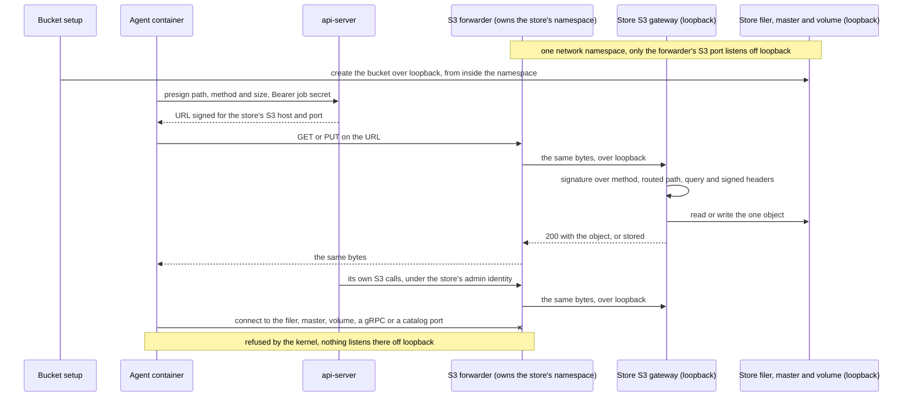

# In the compose stacks, the object store's network namespace listens outside loopback only on its S3 port

**Status:** current

## Context

A presigned URL is meant to authorize one method on one object, and the object store checks that
signature on its S3 port alone. Its other listeners — filer, master, volume, their gRPC ports and
the catalog servers — check no presigned URL at all, and the filer serves, lists, writes and
deletes every object for any caller. Before this change, every compose stack put the store's own
container directly on the stack's shared network with its default flags: every one of those
listeners faced every agent container on it, and the filer's port was also published on the host,
so any agent, or any machine reaching the host, could read, list, overwrite or delete every run's
artifacts without a signature.

## Decision

**An agent container can open a connection to the object store on its S3 port alone, on every
path a compose stack in this repository offers.** The S3 port is where the store checks every
request's signature, so [the presigned-request contract](2026-11-25---01-object-store-acts-only-on-the-signed-object.md)
governs every request an agent can make through it. This contract is about *which ports an agent
can reach at all* — TCP and UDP, to any listener in the store's network namespace — and says
nothing about what the S3 port itself serves; that remains the presigned-request contract's job.

**The store's network namespace belongs to a TCP forwarder (`nginx:alpine`'s `stream` module),
which is the only listener the network sees.** The forwarder listens on the S3 port on all
interfaces and forwards each connection's bytes, unchanged, to the store's S3 gateway on a loopback
port of its own — one namespace cannot hold a listener on all interfaces and another on loopback on
the same port. The store joins that namespace and binds and advertises every listener on loopback,
so none of master, volume, filer, the S3 gateway, its gRPC port or the catalog servers faces the
network. The filer's host port is dropped along with it: nothing outside the namespace used it
except the one-shot bucket setup, which now runs inside the namespace too, over loopback. Checked
against the pinned image: presigned transfers work through the forwarder, an unsigned request
still gets 403, a forwarding-prefix retarget is still refused (the forwarder's loopback peer is not
on the store's trusted-proxy allowlist, which stays empty), and every other store port refuses a
peer container's connection outright.

**The forwarder owns the namespace and the store joins it, not the other way round.** A container
that joins another's network namespace is stranded when that owner restarts, and rejoins when it
restarts itself; no service in these stacks restarts on its own except the store recovering from an
out-of-memory kill under the e2e stack's memory cap. The container that gets started again on its
own must be the one that joins, so the store keeps that role and the forwarder takes over the
store's old service name, published S3 port and the health-gate role dependents wait on. The
forwarder's own health check probes through itself to the store's gateway, so a store stranded
outside the namespace (an operator restarting it by its old name) turns the forwarder unhealthy
rather than failing silently.

**A deployment that runs agents outside these compose stacks must hold them to the store's S3 port
with its own network controls.** This repository's slice of the contract covers only what these
stacks do; it is not a claim about any other deployment's enforcement.

`web-ui/e2e/specs/object-store-reach.spec.ts` holds this contract from inside a real agent
container: the 403/presigned-round-trip pair above, a refusal on every other store port, and an
exhaustive read of the store's own socket table so a future store release that opens a new
listener fails the spec at the pin bump. `scripts/oss-smoke.sh` asserts the same single-listener
property on the canonical stack, which no e2e run boots.

### Rejected

- **B. Bind every listener except the S3 gateway to loopback with store flags alone.** No new
  container, but the S3 gateway's own gRPC port would stay on the network, and any default-on
  listener a future store release adds would follow the S3 bind rather than loopback — so the
  fix would need rechecking at every pin bump rather than holding automatically.
- **C. A separate network for agents, with an S3 proxy on it.** Also keeps agents off the database
  and Temporal, but every service agents call — the api-server and the Worker among them — would
  have to join that network too, a second membership list kept by hand in every stack, and the
  store's name would resolve to the proxy on one network and to the store on the other.
- **D. Turn on the store's own authentication for its other ports.** The store would enforce this
  itself, but it costs per-stack signing keys and gRPC certificates, and a store configured unlike
  any deployment this project ships.
- **An HTTP proxy instead of a TCP forward.** Could filter and log the way a deployment's own edge
  does, but an HTTP proxy rewrites `Host` by default and must be tuned to keep the path, headers
  and streamed body intact or the store's signature check fails or changes meaning. A byte-for-byte
  TCP forward lets the store verify exactly what the agent sent, with nothing to misconfigure.

## Consequences

- A store release that opens a new network-facing listener is caught at the pin bump, by the e2e
  spec's exhaustive socket-table read, before any deployment runs it.
- Existing compose installs move to this layout on their next `up`: it recreates the store's
  service as the forwarder and starts the store beside it on the same data volume. The filer's
  browser UI, previously reachable from the host, no longer is — run artifacts stay visible through
  the web UI and the API instead.
- If the forwarder itself is restarted (not the store), the store is stranded outside its namespace
  and every transfer fails until the stack is brought up again. This is accepted: the forwarder is
  a stateless byte forward with no memory cap, so only a deliberate restart reaches it, and its
  own health check turns the stranded case visibly red rather than silent.
- The compose stacks remain a trusted-tenant environment, not a tenant boundary: an agent container
  still reaches the database, Temporal and other runs' Docker sidecars, none of which is a path to
  the store's ports. A deployment meaning to run agents of tenants that do not trust each other
  needs more than this change.
